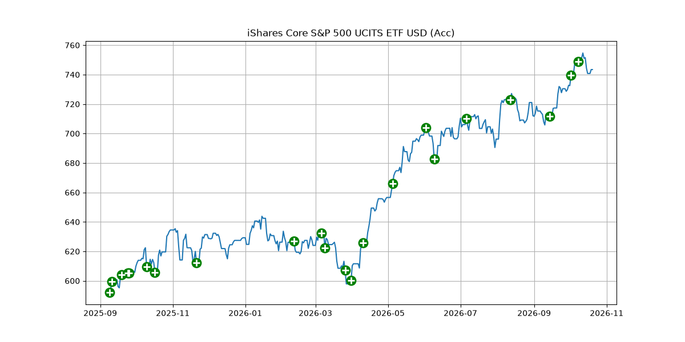
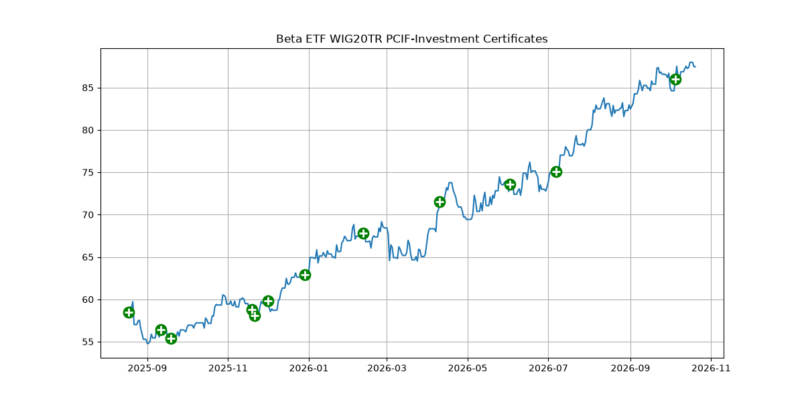
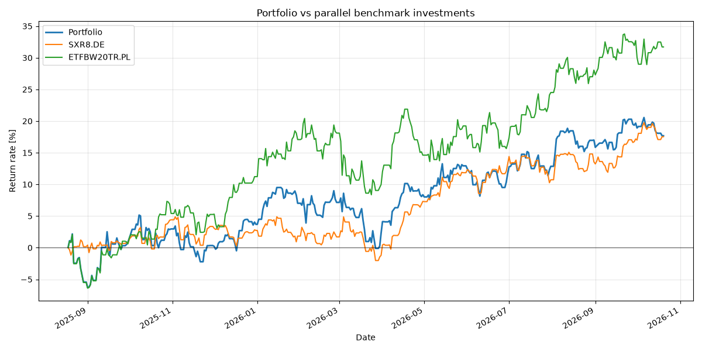

# XTB Portfolio Visualizer

A Python-based portfolio analysis and visualization tool for investors using **XTB**.

The application imports transaction history from an XTB Excel report, retrieves historical market data using Yahoo Finance, and generates visualizations to help users understand their investment performance, portfolio allocation, and dividend income.

The project is currently under development and was initially created to analyze my own long-term investment portfolio.

## Features

### 1. Transaction visualization

Display historical stock or ETF prices with markers indicating purchase transactions.

- Select an instrument from your XTB portfolio.
- Retrieve its historical price data.
- Visualize purchase dates directly on the price chart.





### 2. Price change analysis

Analyze the price performance of instruments held in your portfolio across several time intervals:

- 7 days
- 30 days
- 90 days
- 365 days

Results are presented in a summary table.

### 3. Portfolio vs. benchmark comparison

Compare your actual investment portfolio against hypothetical investments in selected market benchmarks.

Instead of simply comparing price changes, the application simulates investing the same amounts in benchmark instruments on the same dates as your real purchases.

Currently configured benchmarks include:

- SXR8.DE — S&P 500 ETF
- ETFBW20TR.PL — WIG20 TR ETF

The comparison includes:

- Historical portfolio value calculated on a daily basis.
- Cumulative invested capital.
- Portfolio and benchmark return rates.
- Currency conversion into PLN using historical exchange rates.
- Charts comparing the resulting investment performance.

This feature uses the actual timing and amounts of your purchases to provide a more meaningful comparison than a simple index price chart.



### 4. Dividend analysis

Analyze dividend-related transactions recorded in your XTB report.

The application generates charts showing:

- Dividend totals by year.
- Dividend totals by company.

Relevant dividend taxes and withholding-tax transactions are included in the calculations.

### 5. Portfolio allocation

Visualize how the current portfolio is distributed across investments.

The application produces two pie charts:

- Allocation by individual instrument.
- Allocation by asset category.

This helps investors understand portfolio concentration and identify potential rebalancing needs.

## Technologies

- **Python** — core application logic
- **pandas** — transaction processing and time-series analysis
- **Matplotlib** — charts and visualizations
- **yfinance** — historical market prices, metadata, and exchange rates
- **openpyxl** — reading Excel reports
- **pytest** — unit testing
- **GitHub Actions** — automated test execution

## Installation

### Requirements

- Python 3.13 (tested development environment)
- pip
- An XTB Excel account report
- Internet access for downloading market data

### 1. Clone the repository

```bash
git clone https://github.com/Grodek17/Portfolio_Visualizer_XTB.git
cd Portfolio_Visualizer_XTB
```

### 2. Create a virtual environment

```bash
python -m venv .venv
```

Activate the environment.

**Windows PowerShell:**

```powershell
.\.venv\Scripts\Activate.ps1
```

**Linux / macOS:**

```bash
source .venv/bin/activate
```

### 3. Install dependencies

```bash
python -m pip install -r requirements.txt
```

### 4. Prepare your XTB report

Export your account history from XTB in Excel format.

Place the exported report in the root directory of the project and rename it to:

`portfolio.xlsx`

The application expects the file path specified in `data/constants.py`.

**Privacy:** Financial reports should be kept locally and must not be committed to the repository. Excel reports are excluded by `.gitignore`.

## Usage

Run the application from the project's root directory:

```bash
python main.py
```

The command-line menu provides five options:

```text
[1] Buy/sell transaction graph
[2] Price changes across selected intervals
[3] Portfolio vs. benchmark comparison
[4] Dividend analysis
[5] Portfolio allocation
[q] Quit
```

Select an option by entering its number.

Some operations require downloading historical price data and may take additional time depending on the number of instruments and the length of the investment history.

## Project Structure

```text
Portfolio_Visualizer_XTB/
├── .github/workflows/     CI configuration
├── classes/               Asset and Position classes
├── cli/                   Command-line interface
├── data/                  Configuration and ticker mappings
├── docs/                  Development notes and planned improvements
├── features/              Portfolio analysis and visualization
├── helper_functions/      XTB report parsing and utilities
├── tests/                 Unit tests
├── main.py                Application entry point
├── requirements.txt       Runtime dependencies
├── requirements-dev.txt   Development and testing dependencies
└── README.md
```

## Implementation Details

### Historical market data

The application retrieves historical price data from Yahoo Finance using `yfinance`.

An `Asset` class encapsulates information about individual instruments, including their ticker, currency, name, and historical prices.

Market data is downloaded for a requested period and stored in a pandas DataFrame, allowing the application to reuse previously retrieved prices rather than repeatedly requesting individual daily values.

Missing calendar dates, including weekends and market holidays, are handled using forward and backward filling.

### Transaction processing

The XTB report is processed using pandas.

The application extracts transaction dates, instrument tickers, traded amounts, and transaction details. It also converts supported XTB ticker formats into Yahoo Finance-compatible symbols.

A `Position` class maintains information about individual holdings, including purchased quantities and average purchase prices.

### Benchmark simulation

The application reconstructs portfolio performance over time by processing historical investment transactions.

For each investment date, an equivalent amount is hypothetically invested in each benchmark. Portfolio values and benchmark values are then calculated throughout the observation period.

Currency conversion allows instruments denominated in different currencies to be compared in PLN.

## Testing

Unit tests are implemented using `pytest`.

Install development dependencies:

```bash
python -m pip install -r requirements-dev.txt
```

Run the tests:

```bash
python -m pytest -v
```

The current tests cover selected calculations related to benchmark returns and simulated benchmark positions.

GitHub Actions automatically runs the test suite on pushes and pull requests.

## Current Limitations

This project is still under active development.

Known limitations include:

- Benchmark calculations currently focus on purchase transactions; handling sales is not yet complete.
- Portfolio transaction calculations assume a PLN-denominated account.
- XTB report parsing depends on the current layout and naming conventions of the exported Excel file.
- Market-data downloads require internet access and depend on data availability from Yahoo Finance.
- Some edge cases, such as empty datasets, missing prices, and unsupported instruments, need more robust error handling.
- The program currently uses a command-line interface rather than a graphical application.

The project is intended for personal analysis and educational purposes, not as a substitute for official brokerage reports or investment advice.

## Planned Improvements

- Complete handling of sell transactions.
- Improve error handling and input validation.
- Extend automated test coverage.
- Improve support for different currencies and report formats.
- Make report file configuration more flexible.
- Expand portfolio analytics and visualizations.

## Background

This is a personal project created to combine my interests in investing, Python programming, and data analysis.

It also serves as a practical opportunity to develop skills in working with real-world financial data, external APIs, time-series processing, object-oriented programming, testing, and continuous integration.

The project is being developed incrementally as new features and improvements are introduced.


## Tests
python -m pytest tests -v
